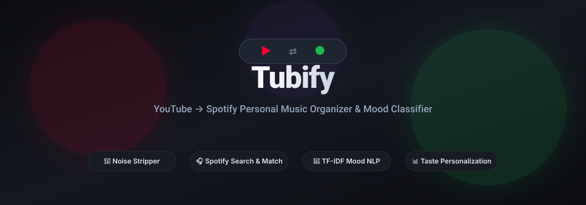
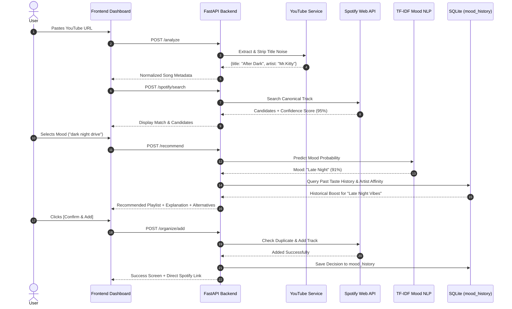

<div align="center">
  

  <p>
    <strong>A portfolio-grade personal music assistant that bridges song discovery on YouTube with your Spotify library using NLP mood classification and personalized taste learning.</strong>
  </p>

  <p>
    <a href="#-key-features">Features</a> •
    <a href="#-architecture--data-flow">Architecture</a> •
    <a href="#-machine-learning--evaluation">ML Benchmark</a> •
    <a href="#-quickstart--local-setup">Quickstart</a> •
    <a href="#-api-reference">API Docs</a> •
    <a href="#-docker--deployment">Deployment</a>
  </p>

  <p>
    
    
    
    
    
  </p>
</div>

---

## 💡 The Core Problem

When discovering music on YouTube (indie uploads, synthwave channels, live sessions, or slowed/reverb edits):
1. **Title noise** (like `[Official 4K]`, `[Lyrics]`, or `(Slowed + Reverb)`) makes searching Spotify manual and tedious.
2. Manually determining which playlist a song belongs to disrupts listening flow.
3. Users have distinct listening moods (e.g., *"dark night drive"*, *"rainy afternoon study"*) that don't map to static genres.

**Tubify** automates this entire pipeline: paste any YouTube link, let the NLP engine categorize its vibe, match the canonical song on Spotify, verify the recommendation against your historical taste, and add it with duplicate detection.

---

## 🌟 Key Features

* **🎥 Intelligent YouTube Extraction & Noise Stripping**:
  - Supports standard watch URLs, mobile links, embed links, and YouTube Shorts.
  - Regex cleaner removes boilerplate noise (`(Official Video)`, `[Lyrics]`, `(Slowed + Reverb)`, `(1 Hour Loop)`, `(4K Remaster)`).
  - Clean separation into `(Artist, Song Title)` with intelligent channel name fallbacks.

* **🎧 Spotify Matching & Confidence Scoring**:
  - Field-filtered and fallback catalog search.
  - Calculates confidence metric using `SequenceMatcher` string similarity.
  - Includes alternative candidate switching if confidence is low.
  - Built-in audio preview player for playable tracks.

* **🧠 TF-IDF + Logistic Regression Mood NLP**:
  - Classifies vibe across 7 core moods: **Chill**, **Late Night**, **Sad**, **Romantic**, **Workout**, **Focus**, **Driving**.
  - Trained on balanced natural language phrases, allowing custom queries like *"dark night drive through empty streets"* or *"something peaceful for rainy evening"*.
  - **Stratified 5-Fold Cross-Validation Accuracy**: **96.95% (+/- 2.49%)**.

* **📊 Multi-Factor Hybrid Taste Recommendation**:
  - Backed by SQLAlchemy and SQLite (`mood_history`).
  - Combines NLP semantic probability, past user playlist decisions, time-decay weighting, and artist affinity.
  - Transparent explainability string tells the user exactly *why* a playlist was chosen.
  - Checks if the playlist exists in Spotify; asks permission before creation.

* **🛡️ Safe Spotify Container Management**:
  - Adheres strictly to Spotify's API guidelines treating playlists as target containers.
  - Duplicate detection checks existing playlist tracks before insertion.
  - Zero modifications made without explicit user confirmation.

* **💻 Sleek Single-Page Web Dashboard**:
  - Dark-mode responsive UI in Vanilla HTML/CSS/JS (no heavy framework overhead).
  - Includes a **Demo Mode Toggle** for testing without Spotify developer credentials.
  - Live taste history table showing past decisions.

---

## 🏗️ Architecture & Data Flow



---

## 🧠 Machine Learning & Evaluation

The mood engine employs a **TF-IDF Vectorizer + Logistic Regression** pipeline trained across 7 curated musical contexts.

### 5-Fold Cross-Validation Benchmark
* **Total Corpus Samples**: 98 balanced phrases
* **Evaluation Metric**: Stratified K-Fold Accuracy ($K=5$)
* **Mean CV Accuracy**: **96.95%** ($\pm 2.49\%$)

```text
              precision    recall  f1-score   support
       Chill       1.00      1.00      1.00        15
     Driving       1.00      1.00      1.00        13
       Focus       1.00      1.00      1.00        13
  Late Night       1.00      1.00      1.00        15
    Romantic       1.00      1.00      1.00        14
         Sad       1.00      1.00      1.00        15
     Workout       1.00      1.00      1.00        13
    accuracy                           1.00        98
```

Run the benchmark script yourself:
```powershell
python scripts/evaluate_ml.py
```

---

## 📐 Hybrid Recommendation Formula

The target playlist recommendation score for a playlist $P$ given user query $Q$ and artist $A$ is modeled as:

$$\text{Score}(P) = w_{\text{nlp}} \cdot S_{\text{nlp}}(P) + w_{\text{hist}} \sum_{i} \text{Sim}(Q, Q_i) \cdot e^{-\lambda \Delta t_i} + w_{\text{artist}} \cdot \text{Affinity}(A, P) + E(P)$$

Where:
1. $S_{\text{nlp}}(P)$: Calibrated probability from TF-IDF classifier.
2. $\text{Sim}(Q, Q_i) \cdot e^{-\lambda \Delta t_i}$: Text similarity to past queries with exponential recency decay ($\lambda = 0.02$).
3. $\text{Affinity}(A, P)$: Boost if the user has previously grouped this artist into playlist $P$.
4. $E(P)$: Library alignment bonus if playlist already exists in Spotify library.

---

## 🚀 Quickstart & Local Setup

### 1. Clone & Set Up Environment
```powershell
git clone https://github.com/codeCrusaders-png/tubify.git
cd tubify

# Create and activate virtual environment
python -m venv .venv
.\.venv\Scripts\Activate.ps1   # Windows
# source .venv/bin/activate    # macOS / Linux

# Install dependencies
pip install -r requirements.txt
```

### 2. Configure Environment Variables
Copy the template configuration:
```powershell
Copy-Item .env.example .env
```
Add your Spotify credentials from [developer.spotify.com](https://developer.spotify.com/dashboard):
```env
SPOTIFY_CLIENT_ID="your_spotify_client_id"
SPOTIFY_CLIENT_SECRET="your_spotify_client_secret"
SPOTIFY_REDIRECT_URI="http://127.0.0.1:8000/auth/spotify/callback"
```
*(Tip: In your Spotify Dashboard, set the Redirect URI to `http://127.0.0.1:8000/auth/spotify/callback`).*

### 3. Start Application
```powershell
uvicorn app.main:app --reload --host 127.0.0.1 --port 8000
```
Open **[http://127.0.0.1:8000](http://127.0.0.1:8000)** in your browser.

> **Note on Demo Mode:** If you do not have Spotify Developer credentials yet, simply toggle **Demo Mode** in the top-right corner to test the full YouTube analysis, mood NLP, and recommendation flow with simulated Spotify catalog data!

---

## 🧪 Running Automated Tests

All 29 tests run in under 5 seconds with mocked external APIs:

```powershell
pytest -v
```

```text
======================== 29 passed in 4.32s ========================
```

---

## 📡 API Reference

| Method | Endpoint | Description |
| :--- | :--- | :--- |
| `GET` | `/health` | Server heartbeat check |
| `POST` | `/analyze` | Extracts and normalizes song title/artist from YouTube URL |
| `POST` | `/spotify/search` | Searches Spotify tracks and calculates candidate confidence |
| `GET` | `/spotify/playlists` | Retrieves user's Spotify playlists (Bearer auth) |
| `POST` | `/recommend` | Generates playlist recommendation from mood & taste history |
| `POST` | `/organize/add` | Checks duplicates, creates playlist if missing, and adds track |
| `GET` | `/organize/history` | Returns past organization decisions from SQLite |
| `GET` | `/auth/spotify/login` | Redirects to Spotify OAuth authorization |
| `GET` | `/auth/spotify/callback` | Exchanges authorization code for access & refresh tokens |

Interactive Swagger documentation is available at **`/docs`**.

---

## 🐳 Docker & Deployment

### Run with Docker Compose
```bash
docker-compose up --build -d
```

### Deploy to Render / Railway
This repository contains a ready-to-deploy `render.yaml` and `Procfile`.
1. Connect this GitHub repo to **Render** or **Railway**.
2. Supply `SPOTIFY_CLIENT_ID` and `SPOTIFY_CLIENT_SECRET` in the dashboard environment variables.
3. Render will deploy using the configuration in `render.yaml`.

---

## 📄 License
MIT License. Created by [Anuj](https://github.com/codeCrusaders-png).
