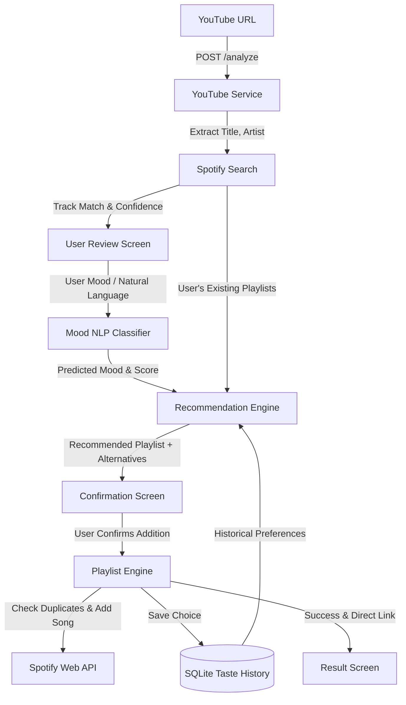

# YouTube → Spotify Personal Music Organizer

A portfolio-grade personal music assistant that bridges song discovery on YouTube with your Spotify library. It automatically extracts song metadata from YouTube URLs, cleans noisy titles, searches and matches canonical tracks on Spotify, predicts mood using a machine learning NLP classifier, personalizes recommendations based on historical listening taste, and manages playlists via Spotify OAuth 2.0.

---

## 🌟 Key Features

1. **YouTube Song Intelligence**:
   - Analyzes standard watch URLs, shorts, embed, and mobile links.
   - Intelligent title normalizer stripping noisy tags like `(Official Music Video)`, `[Lyrics]`, `(Slowed + Reverb)`, `(1 Hour Loop)`, `(4K Remaster)`.
   - Artist & title separation with fallback to YouTube channel/artist analysis.

2. **Spotify Track Matching Engine**:
   - Exact and fuzzy track search with `SequenceMatcher` confidence scoring.
   - Low-confidence candidate picker allowing users to verify ambiguous songs or alternate versions.
   - Cover art, album, and preview extraction.

3. **Mood & Vibe NLP Engine**:
   - 7 core mood categories: **Chill**, **Late Night**, **Sad**, **Romantic**, **Workout**, **Focus**, **Driving**.
   - TF-IDF vectorizer + Logistic Regression classifier trained on a rich natural language corpus.
   - Accepts custom natural language inputs (e.g. *"dark night drive through empty streets"*, *"something peaceful for rainy evening"*) and maps them accurately with confidence scores.
   - Includes automatic AI decision mode.

4. **Personal Taste & Recommendation Engine**:
   - SQLite database backed by SQLAlchemy tracking `mood_history`.
   - Frequency- and similarity-based personalization: learns that if you associate *"night drive"* with *"Midnight Cruise"*, future similar inputs boost that playlist.
   - Recommends existing user playlists or prompts for permission to create new playlists.
   - Always provides alternative recommendations.

5. **Safe Spotify Playlist Management**:
   - Spotify OAuth 2.0 with safe scoped permissions (`playlist-modify-public`, `playlist-modify-private`, `playlist-read-private`).
   - Duplicate detection: checks existing playlist tracks before adding.
   - Never modifies or creates playlists without explicit user confirmation.

6. **Interactive Single-Page UI**:
   - Modern, responsive dark-themed dashboard built with semantic HTML, CSS, and vanilla JavaScript.
   - Real-time feedback, interactive candidate switching, mood chips, and live taste history table.

---

## 🏗️ Architecture & Data Flow



---

## 📁 Project Structure

```
youtube-spotify-music-organizer/
├── app/
│   ├── main.py                     # FastAPI application factory & static mount
│   ├── api/
│   │   └── routes/
│   │       ├── analyze.py          # POST /analyze (YouTube metadata extraction)
│   │       ├── auth.py             # GET /auth/spotify (OAuth login, callback, refresh)
│   │       ├── health.py           # GET /health
│   │       ├── organize.py         # POST /organize/add, GET /organize/history
│   │       ├── recommend.py        # POST /recommend
│   │       └── spotify.py          # POST /spotify/search, GET /spotify/playlists
│   ├── core/
│   │   └── config.py               # Pydantic Settings & environment config
│   ├── models/
│   │   ├── database.py             # SQLAlchemy models (MoodHistory) & SQLite init
│   │   └── schemas.py              # Pydantic request & response models
│   ├── services/
│   │   ├── mood_service.py         # TF-IDF + Logistic Regression NLP classifier
│   │   ├── recommendation_service.py# Taste personalization & recommendation engine
│   │   ├── spotify_service.py      # Spotify OAuth, search, duplicate check & playlists
│   │   └── youtube_service.py      # YouTube extraction, noise cleaner & normalizer
│   └── utils/
├── static/
│   ├── index.html                  # Single-page application interface
│   ├── style.css                   # Responsive dark UI styling
│   └── app.js                      # Reactive frontend controller
├── tests/
│   ├── test_analyze_route.py       # Tests for YouTube analysis endpoint
│   ├── test_health.py              # Tests for health endpoint
│   ├── test_mood_service.py        # Tests for NLP classifier & phrase mapping
│   ├── test_organize_routes.py     # Tests for organize & history endpoints
│   ├── test_playlist_engine.py     # Tests for playlist duplicate checking & creation
│   ├── test_recommendation_service.py # Tests for taste learning & recommendation
│   ├── test_spotify_service.py     # Tests for track search & candidate ranking
│   └── test_youtube_service.py     # Tests for YouTube URL parsing & title cleaning
├── data/
│   └── music_organizer.db          # Local SQLite database
├── .env.example                    # Environment variable template
├── .gitignore
├── requirements.txt
└── README.md
```

---

## 🚀 Setup & Local Execution

### 1. Prerequisites
- Python 3.10+ (tested on Python 3.14)
- A Spotify Developer account (free) to get a Client ID and Client Secret.

### 2. Virtual Environment Setup
```powershell
# Create virtual environment
python -m venv .venv

# Activate on Windows (PowerShell)
.\.venv\Scripts\Activate.ps1

# Activate on macOS/Linux
source .venv/bin/activate
```

### 3. Install Dependencies
```powershell
pip install -r requirements.txt
```

### 4. Configuration (.env)
Copy the example file to `.env`:
```powershell
Copy-Item .env.example .env
```
Open `.env` and fill in your Spotify Developer credentials:
```env
SPOTIFY_CLIENT_ID="your_spotify_client_id"
SPOTIFY_CLIENT_SECRET="your_spotify_client_secret"
SPOTIFY_REDIRECT_URI="http://127.0.0.1:8000/auth/spotify/callback"
```

*(Note: In your [Spotify Developer Dashboard](https://developer.spotify.com/dashboard), add `http://127.0.0.1:8000/auth/spotify/callback` to your App's Redirect URIs).*

### 5. Start the Application
```powershell
uvicorn app.main:app --reload --host 127.0.0.1 --port 8000
```
Open your browser to:
- **Web App**: [http://127.0.0.1:8000/](http://127.0.0.1:8000/)
- **Swagger API Docs**: [http://127.0.0.1:8000/docs](http://127.0.0.1:8000/docs)
- **Health Check**: [http://127.0.0.1:8000/health](http://127.0.0.1:8000/health)

---

## 🧪 Running Tests

Run the test suite with `pytest`:
```powershell
pytest -v
```

All 23 unit and integration tests run in under 2 seconds, mocking external network services to ensure 100% deterministic test execution.

